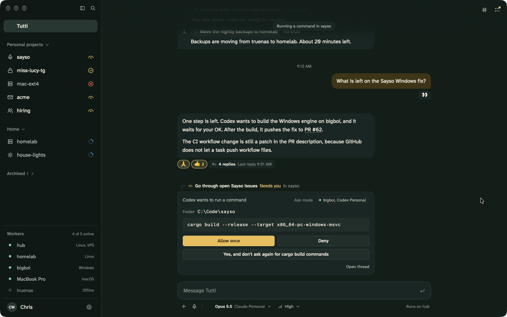

<p align="center">
  
</p>

<h1 align="center">Consort</h1>

<p align="center">
  <a href="https://github.com/watzon/consort/releases/latest"></a>
  <a href="https://github.com/watzon/consort/actions/workflows/ci.yml"></a>
  <a href="LICENSE"></a>
</p>

Consort is a personal AI assistant that you host yourself. You talk to one assistant in one place. The assistant does its work on your own machines, with the coding harnesses and accounts that you already have.



Consort is written in Rust. The desktop app uses [GPUI](https://www.gpui.rs/).

> [!NOTE]
> Consort is at an early stage. Expect changes to the data and the protocol between releases. See [Status](#status) for what is not finished.

## What Consort does

- **One assistant.** The assistant has one set of skills and one memory in every channel.
- **Channels.** Tutti is the main channel. It can read and message your project channels, so you can ask about all your work in one place.
- **Tasks.** A task runs as its own session and reports in its own thread. A channel can have many tasks at the same time.
- **Your machines.** Sessions run on your workers, with access to the files, repos, shell and local network of each machine.
- **Any harness.** Consort drives Claude Code, Codex, OpenCode, Gemini CLI, Pi, and any other harness that speaks the Agent Client Protocol (ACP).
- **Approvals.** When a session asks to run a command or change a file, the request comes to you, and you can allow or deny it.
- **Account fallback.** If an account hits its usage limit, the session can move to another account of the same provider.
- **Routines.** The assistant can do work on a schedule and tell you when it needs you.
- **Writes in your voice, with your consent.** The assistant can learn how you write from the sources that you choose, and it asks before it sends.

## How it works

```
   Desktop app            Other clients
        \                     /
         \    Client API     /
          v                 v
   +-----------------------------+
   |  Hub                        |
   |  conversations, tasks,      |
   |  memory, routines           |
   +-----------------------------+
          |                 |
          |   Worker link   |
          v                 v
      +--------+        +--------+
      | Worker |        | Worker |
      | Mac    |        | Linux  |
      +--------+        +--------+
```

- The **hub** is an always-on program, usually on a small server. It stores all conversations and decides what runs where.
- A **worker** is a machine that runs sessions for the hub. Your harness credentials stay on the worker.
- A **client** is an app that you use to talk to the assistant. The desktop app is the only client at this time.
- **Pairing** is the one-time step that makes the hub trust a new worker or client.

[CONTEXT.md](CONTEXT.md) defines these terms and the others that the project uses.

## Get started

To use Consort, you need three things: a hub, the desktop app, and at least one worker. The hub has a worker of its own, so one server and one app are enough to start.

### 1. Run a hub

The `consort` program contains the hub and the worker. Download it for your server from the [newest release](https://github.com/watzon/consort/releases/latest), and then follow [Run a hub on a server](docs/deploy.md). That guide covers systemd, HTTPS with Caddy, Docker, and pairing your first app.

### 2. Install the desktop app

| System | Download |
|---|---|
| macOS, Apple Silicon | [Consort-macos-arm64.dmg](https://github.com/watzon/consort/releases/latest/download/Consort-macos-arm64.dmg) |
| macOS, Intel | [Consort-macos-x86_64.dmg](https://github.com/watzon/consort/releases/latest/download/Consort-macos-x86_64.dmg) |
| Windows, x86_64 | [Consort-desktop-windows-x86_64.zip](https://github.com/watzon/consort/releases/latest/download/Consort-desktop-windows-x86_64.zip) |
| Linux, x86_64 | [Consort-desktop-linux-x86_64.tar.gz](https://github.com/watzon/consort/releases/latest/download/Consort-desktop-linux-x86_64.tar.gz) |

The macOS app of this release is not notarized, so macOS blocks it the first time. To open it, go to System Settings > Privacy & Security and select **Open Anyway**.

### 3. Add a worker

In the app, go to Settings > Workers and select **Add worker**. The dialog gives you a command with a one-time code. On Linux or macOS, the command looks like this:

```sh
curl -fsSL https://raw.githubusercontent.com/watzon/consort/main/scripts/install/worker.sh \
  | bash -s -- --hub https://hub.example.com --code ABCD-EFGH
```

[Install Consort](docs/install.md) has the PowerShell command, the service commands, and the update steps.

## Build from source

You need the Rust toolchain. `rust-toolchain.toml` selects the version. On Linux, `scripts/linux-deps.sh` installs the system packages on Debian and Ubuntu.

```sh
scripts/dev.sh           # build and start a dev hub, its worker, and the app
scripts/dev.sh --mock    # start only the app, with example data
scripts/check.sh         # format check, clippy, and all tests
```

A dev run keeps its data in `~/.consort-dev`, apart from a real hub.

### Crates

| Crate | Purpose |
|---|---|
| `consort-proto` | The types of the client API and the worker link |
| `consort-theme` | Theme files, contrast checks, and the app theme |
| `consort-harness` | The adapters that drive each harness |
| `consort-worker` | The worker |
| `consort-hub` | The hub |
| `consort-tools` | Managed tools for workers: download, check, and install |
| `consort-client` | The client logic. It does not depend on GPUI |
| `consort-desktop` | The GPUI desktop app |
| `consort-cli` | The `consort` program: `hub`, `worker`, `dev`, and `mcp-bridge` |
| `consort-testkit` | A fake harness and helpers for tests |

### CI

A push or a pull request runs the fast checks: the format check and the install script test. The full test suite builds GPUI on macOS, Linux and Windows, so it runs only when you start it:

```sh
gh workflow run ci.yml
```

A tag such as `v0.1.0` starts the [release workflow](.github/workflows/release.yml). See [Make a release](docs/install.md#make-a-release).

## Documentation

| Page | Content |
|---|---|
| [Architecture](docs/architecture.md) | How the system fits together, and why |
| [Run a hub on a server](docs/deploy.md) | Install, HTTPS, Docker, backup, and upgrade |
| [Install Consort](docs/install.md) | Workers, the desktop app, updates, and releases |
| [Protocol](docs/protocol.md) | The client API, the worker link, and the hub tools |
| [Data model](docs/data-model.md) | Entities and state machines |
| [Harness adapters](docs/harness-adapters.md) | How workers drive each harness |
| [Design system](docs/design-system.md) | Themes, type, spacing, motion, and glyphs |
| [Architecture decision records](docs/adr/) | The large decisions and the options we rejected |
| [Decision log](docs/DECISIONS.md) | The smaller decisions, in order |

## Status

v0.1.0 is the first public release. It is built for one user.

- **Tests with real accounts.** The test suite uses fake harnesses and a fake hub. Account fallback and the tests that need a real harness have not run against real accounts.
- **Mobile.** There is no mobile app yet.
- **Dictation.** The microphone button in the composer cannot start dictation yet.
- **Windows and Linux.** The desktop builds for these systems are best effort. If a build fails, its file is missing from the release.
- **Safety limits.** Generic ACP and Pi coordinators keep their shell and web tools. Run them only on machines where you accept that.
- **Files.** Artifacts that are not documents open in the system app, with no confirmation.

## License

[MIT](LICENSE). The fonts are under the SIL Open Font License ([crates/consort-desktop/assets/fonts/OFL.txt](crates/consort-desktop/assets/fonts/OFL.txt)). The provider logos come from Lobe Icons and remain the marks of their owners ([NOTICE](crates/consort-desktop/assets/providers/NOTICE.md)).
